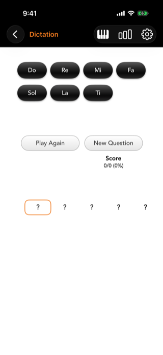
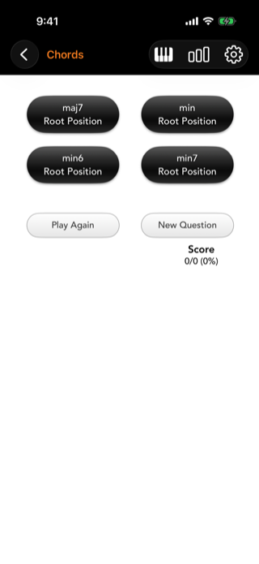
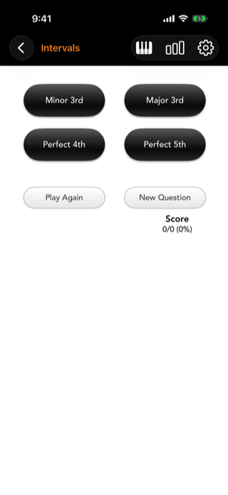
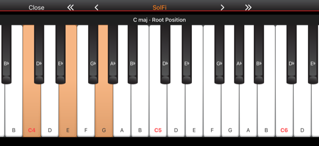
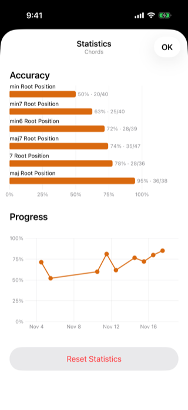

# SolFi Ear Trainer
 
SolFi Ear Trainer 4™ (for iPhone/iPad) is an ear training application for students of music to improve their listening skills. It contains some basic exercises used by many schools to teach their students. It assumes the user has some knowledge of music theory.

It contains three exercises:

1. *Pitch Dictation* - Given a tonic note, one or more notes are played sequentially. The user is asked to annotate the sequence using solfege or pitch names (for perfect pitch/absolute pitch). The user can choose up to four parts.
1. *Chord Identification* - Three or more notes from a specific key are played melodically or harmonically. The user is asked to choose from a given set of chords and inversions.
1. *Interval Identification* - Two notes are played melodically or harmonically. The user is asked to choose from a given set of intervals. This can be used to improve one's relative pitch skills.

SolFi 4 keeps your SolFi 3 preferences when you update.

## Pitch Dictation
This exercise will help improve your listening skills using solfege/pitch names. A melody is played and you must identify each note in the melody using the notes on top. Your answer for each note appears on the bottom. Once you finish, press `Verify` to validate your answer. If your answer is correct, a new melody is played. If it is incorrect, the incorrect notes will be highlighted in red and the correct answer will be shown beneath each incorrect note.

## Chord Identification
This exercise will help you distinguish between different chords. Chords can be played harmonically/melodically (by changing the bpm setting) and ascending/descending. Correct answers will cause a new chord to play. For incorrect answers, the correct answer will be shown, and you can play your answer and the correct one to compare them. If your answer has exactly the same notes as the chord played (for example min6 and min7♭5 in 1st inversion), it counts as correct.

## Interval Identification
This exercise will help you distinguish between different intervals. Intervals can be played harmonically/melodically (by changing the bpm setting) and ascending/descending. Correct answers will cause a new interval to play. For incorrect answers, the correct answer will be shown, and you can play your answer and the correct one to compare them.

## Keyboard
A keyboard helps with any exercise or just general practice. On iPhone, tap the piano icon at the top of the screen to open it full screen; on iPad it sits under each exercise. Use the arrows to move one key or one octave. When viewed from an exercise, the keyboard scrolls to the tonic note (or, for chords and intervals, to the lowest note played) and labels the keys with solfege, letters or intervals to match the exercise settings.

While you play, the bar above the keys names what you're holding: a note, an interval, or a chord with its inversion. After you answer a chord or interval, playing your answer or the correct one lights its keys. You can also play the keyboard from a MIDI keyboard, connected by cable or Bluetooth (see `Preferences` on the main menu).

## Statistics
Tap the chart icon in any exercise to see how accurate you are with each note, chord or interval (weakest first) and how you're improving day by day. Exercises also play the notes, chords and intervals you miss most a little more often.

## FAQ
- **Q: I don't hear any sound from the application**
- A: Turn up the volume with the volume buttons. SolFi plays even when the phone is on silent.
- **Q: In Pitch Dictation, how do I choose which octaves the notes come from**
- A: In the preferences, set `Lowest Note` and `Highest Note`.
- **Q: In Pitch Dictation, how can I do perfect pitch training**
- A: In the preferences, set the `Note Name Type` setting to be `Letter`. That's it. Optionally, you can also change `Lowest Note`, `Highest Note` and `Tonic Note` settings as needed.
- **Q: In Chord/Interval Identification, how can I hear chords melodically**
- A: In the preferences, set the `Bpm` setting to be greater than 0.
- **Q: How do I start my statistics over**
- A: In an exercise's statistics, tap `Reset Statistics`. To clear every exercise at once, use `Reset All Statistics` in `Preferences` on the main menu.

## Contact
Email: RANDOMSTUFF -at- ACIDRAINSTORM -dot- COM
